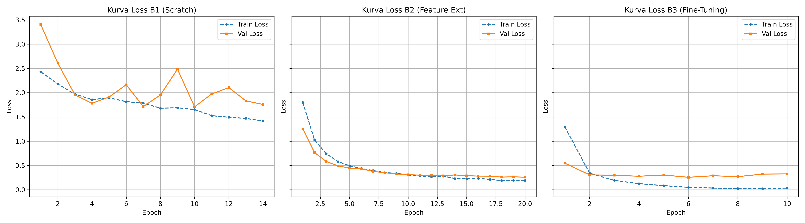
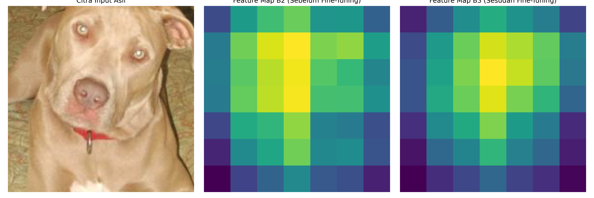

# Benchmarking Transfer Learning Strategies on Limited Data (Oxford-IIIT Pet)

[](https://pytorch.org/)
[](https://pytorch.org/vision/stable/index.html)
[](https://www.python.org/)
[](https://opensource.org/licenses/MIT)

An empirical study evaluating fine-tuning paradigms, data augmentation strategies, and efficient CNN architectures under severe data constraints (**small-data regime**). This project benchmarks five experimental conditions (B1–B5) on a 10-class subset of the **Oxford-IIIT Pet Dataset** (~2,000 images) using PyTorch.

---

## 📌 Table of Contents
- [Project Overview](#-project-overview)
- [Key Findings](#-key-findings)
- [Experimental Framework (B1–B5)](#-experimental-framework-b1b5)
- [Results Summary](#-results-summary)
- [Visualizations & Feature Map Shift](#-visualizations--feature-map-shift)
- [Repository Structure](#-repository-structure)
- [Installation & Setup](#-installation--setup)
- [How to Run](#-how-to-run)

---

## 📖 Project Overview

Training deep Convolutional Neural Networks (CNNs) from scratch on small datasets often results in severe overfitting and poor generalization. Transfer learning addresses this by transferring representations learned from large-scale datasets (ImageNet-1K).

This repository addresses the core dilemma in deep learning adaptation:
> **When is freezing backbone representations sufficient (Feature Extraction), and under what conditions is deep weight adjustment required (Progressive Fine-Tuning)?**

### Objectives
1. Build a reproducible image classification pipeline using PyTorch and `torchvision`.
2. Compare model convergence and performance across **Training from Scratch (B1)**, **Feature Extraction (B2)**, and **Progressive Fine-Tuning (B3)**.
3. Quantify the impact of **Data Augmentation (B4)** on mitigating generalization gaps.
4. Evaluate compute efficiency trade-offs with modern lightweight architectures (**EfficientNet-B0 - B5**).
5. Analyze feature representation shifts at `layer4` using activation feature map visualization.

---

## 🎯 Key Findings

- **Transfer Learning Advantage**: Utilizing pretrained weights (B2 & B3) boosted Test Macro F1 score from **0.3434** (from scratch) to over **0.9500+**, reducing convergence epochs by more than half.
- **Feature Extraction vs. Fine-Tuning**: Pure Feature Extraction (B2) achieved high accuracy on this subset with minimal trainable parameters (5,130), while Progressive Fine-Tuning (B3) accelerated model convergence to just **6 epochs**.
- **Efficiency of Modern Architectures**: EfficientNet-B0 (B5) achieved competitive performance (**0.9731 Test Macro F1**) using only ~730k trainable parameters, offering an optimal balance of compute efficiency and accuracy.

---

## 🧪 Experimental Framework (B1–B5)

All experiments were conducted under standardized conditions:
- **Dataset**: Oxford-IIIT Pet (10 selected cat & dog breeds, ~2,000 images, stratified 70/15/15 train/val/test split).
- **Input Resolution**: $224 \times 224$ with ImageNet normalization.
- **Optimizer & Loss**: AdamW (`weight_decay=1e-2`), CrossEntropyLoss, Early Stopping (`patience=4`).
- **Reproducibility**: Global seed set to `42`.

| Code | Experimental Condition | Architecture | Strategy Details |
| :---: | :--- | :---: | :--- |
| **B1** | Baseline From Scratch | ResNet-18 | Random initialization (`weights=None`), all layers trainable. |
| **B2** | Feature Extraction | ResNet-18 | Frozen ImageNet backbone, trained `fc` classifier head only. |
| **B3** | Progressive Fine-Tuning | ResNet-18 | Unfrozen `layer4` and `fc`. Differential LR: `1e-4` (`layer4`), `1e-3` (`fc`). |
| **B4** | Fine-Tuning (No Augmentation) | ResNet-18 | Same as B3, but with deterministic spatial cropping/resizing only. |
| **B5** | Modern Architecture Benchmark | EfficientNet-B0 | Pretrained backbone, unfrozen top stage (`features[7]`) and classifier. |

---

## 📊 Results Summary

Metrics extracted directly from `experiment_log.json`:

| Code | Condition | Trainable Params | Learning Rate | Converged Epoch | Training Time (s) | Val Acc | Test Acc | Test Macro F1 |
| :---: | :--- | :---: | :---: | :---: | :---: | :---: | :---: | :---: |
| **B1** | Baseline From Scratch | 11,181,642 | `1e-3` | 10 | 232.29 | 45.64% | 38.67% | **0.3434** |
| **B2** | Feature Extraction | **5,130** | `1e-3 (fc)` | 20 | 155.52 | 91.95% | **98.00%** | **0.9800** |
| **B3** | Progressive Fine-Tuning | 8,398,858 | `1e-4 (l4), 1e-3 (fc)` | **6** | 103.08 | 91.28% | 95.33% | **0.9531** |
| **B4** | Fine-Tuning (No Augmentation) | 8,398,858 | `1e-4 (l4), 1e-3 (fc)` | **6** | **92.63** | 90.60% | 94.00% | **0.9396** |
| **B5** | EfficientNet-B0 Fine-Tuning | **730,042** | `1e-4 (f7), 1e-3 (cls)` | 11 | 189.88 | 91.28% | 97.33% | **0.9731** |

---

## 🖼️ Visualizations & Feature Map Shift

### 1. Performance & Efficiency Comparison


### 2. Feature Map Shift Analysis (`layer4` Activations)
Visualizing activation feature maps before (B2) and after (B3) fine-tuning demonstrates how feature representations adapt:

- **Before Fine-Tuning (B2)**: Activations focus on generic ImageNet features and high-contrast background elements (e.g., grass, furniture, lighting).
- **After Fine-Tuning (B3)**: Attention shifts directly toward breed-specific visual features (e.g., facial structure, ear shape, coat patterns).



---

## 📁 Repository Structure

```text
.
├── main.ipynb                    # Complete Jupyter Notebook (data prep, model training, evaluation)
├── experiment_log.json           # Raw metrics log in JSON format
├── experiment_log.csv            # Raw metrics log in CSV format
├── README.md                     # Project documentation
├── requirements.txt              # Environment dependencies
├── learning_curves_c1.png        # Consolidated metrics plot
└── feature_map_comparison_c5.png # Feature map activation visualization
```

---

## ⚙️ Installation & Setup

1. **Clone the Repository**:
   ```bash
   git clone https://github.com/mark3dition-boop/pet-image-classification-transfer-learning-pytorch.git
   cd pet-image-classification-transfer-learning-pytorch
   ```

2. **Create a Virtual Environment** (Optional but recommended):
   ```bash
   python -m venv venv
   source venv/bin/activate  # On Windows: venv\Scripts\activate
   ```

3. **Install Dependencies**:
   ```bash
   pip install -r requirements.txt
   ```

---

## 🚀 How to Run

1. **Launch Jupyter Notebook**:
   ```bash
   jupyter notebook main.ipynb
   ```
2. **Execute All Cells**: Run the cells sequentially to reproduce dataset filtering, model training (B1–B5), logging, and visualization plots.

---

## 📄 License

This project is open-source and available under the [MIT License](LICENSE).